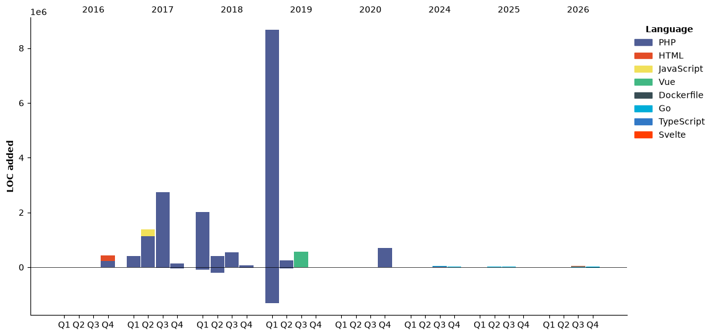

## Hi there 👋
💻 Hi, I'm Jovi (he / him) — a Software Engineer.\
🏠 I live in Jakarta, Indonesia 🇮🇩.\
🤓 I'm a nerd. Love learning, sports ⚽️, and keep healthy 🧘.

## 🔭 I’m currently working on ...
- Go, Node.js
- Vue.js, Nuxt.js
- PHP, Laravel, Yii, CodeIgniter
- Amazon Web Services, Alibaba Cloud

## 🌱 I’m currently learning ...
- Time management

## My values
💖 Honest\
🤓 Beginner's mindset and curiosity\
🙌 Share knowledge\
🧘 Eliminate under pressure

## 🕒 Weekly Development Breakdown
<!--START_SECTION:waka-->


**🐱 My GitHub Data** 

> 📦 191.2 kB Used in GitHub's Storage 
 > 
> 🏆 123 Contributions in the Year 2026
 > 
> 💼 Opted to Hire
 > 
> 📜 41 Public Repositories 
 > 
> 🔑 24 Private Repositories 
 > 
**I'm an Early 🐤** 

```text
🌞 Morning                2211 commits        ██████████░░░░░░░░░░░░░░░   38.40 % 
🌆 Daytime                1711 commits        ███████░░░░░░░░░░░░░░░░░░   29.72 % 
🌃 Evening                1529 commits        ███████░░░░░░░░░░░░░░░░░░   26.55 % 
🌙 Night                  307 commits         █░░░░░░░░░░░░░░░░░░░░░░░░   05.33 % 
```
📅 **I'm Most Productive on Sunday** 

```text
Monday                   712 commits         ███░░░░░░░░░░░░░░░░░░░░░░   12.37 % 
Tuesday                  797 commits         ███░░░░░░░░░░░░░░░░░░░░░░   13.84 % 
Wednesday                782 commits         ███░░░░░░░░░░░░░░░░░░░░░░   13.58 % 
Thursday                 626 commits         ███░░░░░░░░░░░░░░░░░░░░░░   10.87 % 
Friday                   539 commits         ██░░░░░░░░░░░░░░░░░░░░░░░   09.36 % 
Saturday                 922 commits         ████░░░░░░░░░░░░░░░░░░░░░   16.01 % 
Sunday                   1380 commits        ██████░░░░░░░░░░░░░░░░░░░   23.97 % 
```


📊 **This Week I Spent My Time On** 

```text
🕑︎ Time Zone: Asia/Jakarta

💬 Programming Languages: 
Go                       9 hrs 20 mins       ███████████████████░░░░░░   75.90 % 
SQL                      1 hr 4 mins         ██░░░░░░░░░░░░░░░░░░░░░░░   08.78 % 
YAML                     55 mins             ██░░░░░░░░░░░░░░░░░░░░░░░   07.50 % 
Markdown                 47 mins             ██░░░░░░░░░░░░░░░░░░░░░░░   06.49 % 
Other                    6 mins              ░░░░░░░░░░░░░░░░░░░░░░░░░   00.82 % 

🔥 Editors: 
VS Code                  7 hrs 46 mins       ████████████████░░░░░░░░░   63.09 % 
Opencode Cli             2 hrs 49 mins       ██████░░░░░░░░░░░░░░░░░░░   22.89 % 
OpenCode                 1 hr 43 mins        ████░░░░░░░░░░░░░░░░░░░░░   14.02 % 

🐱‍💻 Projects: 
nexus-be                 12 hrs 13 mins      █████████████████████████   99.31 % 
jira                     5 mins              ░░░░░░░░░░░░░░░░░░░░░░░░░   00.69 % 

💻 Operating System: 
Linux                    12 hrs 18 mins      █████████████████████████   100.00 % 
```

🤖 **AI Coding This Week** 

```text
⏱ AI Coding Time: 8 hrs (65.03%)

✍️ 4,464 lines written by AI, 155 lines written by hand (96.64% AI-written)

🔤 3,975,476 Input Tokens, 838,929 Output Tokens

💵 $1181.19 Estimated AI Cost This Week

🧠 15 AI Sessions, 118 AI Prompts

DeepSeek                 4,630 lines         █████████████████████████   100.00 % 

🔎 AI Coding Insights:
🤖 AI-Driven — 96.64% of written lines came from AI
📝 Concise Prompter — average 102 characters per prompt
🔁 Iterative Prompter — average 8 prompts per session
🚀 High AI Trust — 4.71% of changed lines were hand-edited
```

**I Mostly Code in PHP** 

```text
PHP                      35 repos            ███████████████░░░░░░░░░░   58.33 % 
Go                       10 repos            ████░░░░░░░░░░░░░░░░░░░░░   16.67 % 
JavaScript               4 repos             ██░░░░░░░░░░░░░░░░░░░░░░░   06.67 % 
TypeScript               2 repos             █░░░░░░░░░░░░░░░░░░░░░░░░   03.33 % 
Svelte                   1 repo              ░░░░░░░░░░░░░░░░░░░░░░░░░   01.67 % 
```


**Timeline**




 Last Updated on 2026-11-08 03:48:10 UTC
<!--END_SECTION:waka-->

## Get in touch
- Instagram: https://instagram.com/redzjovi
- LinkedIn: https://www.linkedin.com/in/jovi-wang-9951719a
- Personal site: https://tech.bodyfitstation.com

## ✨ Random Dev Quote
[](https://github.com/piyushsuthar/github-readme-quotes)
