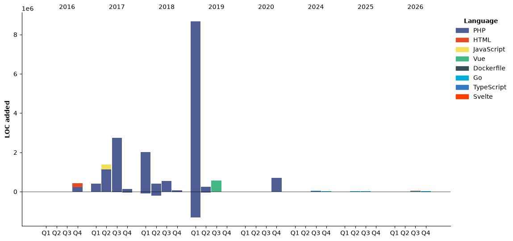

## Hi there 👋
💻 Hi, I'm Jovi (he / him) — a Software Engineer.\
🏠 I live in Jakarta, Indonesia 🇮🇩.\
🤓 I'm a nerd. Love learning, sports ⚽️, and keep healthy 🧘.

## 🔭 I’m currently working on ...
- Go, Node.js
- Vue.js, Nuxt.js
- PHP, Laravel, Yii, CodeIgniter
- Amazon Web Services, Alibaba Cloud

## 🌱 I’m currently learning ...
- Time management

## My values
💖 Honest\
🤓 Beginner's mindset and curiosity\
🙌 Share knowledge\
🧘 Eliminate under pressure

## 🕒 Weekly Development Breakdown
<!--START_SECTION:waka-->


**🐱 My GitHub Data** 

> 📦 191.2 kB Used in GitHub's Storage 
 > 
> 🏆 123 Contributions in the Year 2026
 > 
> 💼 Opted to Hire
 > 
> 📜 41 Public Repositories 
 > 
> 🔑 24 Private Repositories 
 > 
**I'm an Early 🐤** 

```text
🌞 Morning                2211 commits        ██████████░░░░░░░░░░░░░░░   38.40 % 
🌆 Daytime                1711 commits        ███████░░░░░░░░░░░░░░░░░░   29.72 % 
🌃 Evening                1529 commits        ███████░░░░░░░░░░░░░░░░░░   26.55 % 
🌙 Night                  307 commits         █░░░░░░░░░░░░░░░░░░░░░░░░   05.33 % 
```
📅 **I'm Most Productive on Sunday** 

```text
Monday                   712 commits         ███░░░░░░░░░░░░░░░░░░░░░░   12.37 % 
Tuesday                  797 commits         ███░░░░░░░░░░░░░░░░░░░░░░   13.84 % 
Wednesday                782 commits         ███░░░░░░░░░░░░░░░░░░░░░░   13.58 % 
Thursday                 626 commits         ███░░░░░░░░░░░░░░░░░░░░░░   10.87 % 
Friday                   539 commits         ██░░░░░░░░░░░░░░░░░░░░░░░   09.36 % 
Saturday                 922 commits         ████░░░░░░░░░░░░░░░░░░░░░   16.01 % 
Sunday                   1380 commits        ██████░░░░░░░░░░░░░░░░░░░   23.97 % 
```


📊 **This Week I Spent My Time On** 

```text
🕑︎ Time Zone: Asia/Jakarta

💬 Programming Languages: 
Go                       7 hrs 7 mins        █████████████░░░░░░░░░░░░   51.54 % 
YAML                     3 hrs 1 min         █████░░░░░░░░░░░░░░░░░░░░   21.91 % 
SQL                      1 hr 11 mins        ██░░░░░░░░░░░░░░░░░░░░░░░   08.59 % 
Other                    53 mins             ██░░░░░░░░░░░░░░░░░░░░░░░   06.46 % 
Markdown                 52 mins             ██░░░░░░░░░░░░░░░░░░░░░░░   06.28 % 

🔥 Editors: 
VS Code                  6 hrs 4 mins        ███████████░░░░░░░░░░░░░░   44.01 % 
Opencode Cli             4 hrs 2 mins        ███████░░░░░░░░░░░░░░░░░░   29.23 % 
OpenCode                 3 hrs 41 mins       ███████░░░░░░░░░░░░░░░░░░   26.76 % 

🐱‍💻 Projects: 
nexus-be                 12 hrs 27 mins      ███████████████████████░░   90.11 % 
sso                      1 hr 5 mins         ██░░░░░░░░░░░░░░░░░░░░░░░   07.86 % 
k6-perf-test             15 mins             ░░░░░░░░░░░░░░░░░░░░░░░░░   01.83 % 
jira                     1 min               ░░░░░░░░░░░░░░░░░░░░░░░░░   00.21 % 

💻 Operating System: 
Linux                    13 hrs 49 mins      █████████████████████████   100.00 % 
```

🤖 **AI Coding This Week** 

```text
⏱ AI Coding Time: 11 hrs 48 mins (85.46%)

✍️ 3,378 lines written by AI, 162 lines written by hand (95.42% AI-written)

🔤 6,517,198 Input Tokens, 1,027,997 Output Tokens

💵 $738.26 Estimated AI Cost This Week

🧠 17 AI Sessions, 88 AI Prompts

DeepSeek                 3,596 lines         █████████████████████████   98.41 % 
K                        58 lines            ░░░░░░░░░░░░░░░░░░░░░░░░░   01.59 % 
Tencent Hy               0 lines             ░░░░░░░░░░░░░░░░░░░░░░░░░   00.00 % 

🔎 AI Coding Insights:
🤖 AI-Driven — 95.42% of written lines came from AI
📝 Concise Prompter — average 303 characters per prompt
🔁 Iterative Prompter — average 5 prompts per session
🚀 High AI Trust — 8.31% of changed lines were hand-edited
```

**I Mostly Code in PHP** 

```text
PHP                      35 repos            ███████████████░░░░░░░░░░   58.33 % 
Go                       10 repos            ████░░░░░░░░░░░░░░░░░░░░░   16.67 % 
JavaScript               4 repos             ██░░░░░░░░░░░░░░░░░░░░░░░   06.67 % 
TypeScript               2 repos             █░░░░░░░░░░░░░░░░░░░░░░░░   03.33 % 
Svelte                   1 repo              ░░░░░░░░░░░░░░░░░░░░░░░░░   01.67 % 
```


**Timeline**




 Last Updated on 2026-11-18 05:29:58 UTC
<!--END_SECTION:waka-->

## Get in touch
- Instagram: https://instagram.com/redzjovi
- LinkedIn: https://www.linkedin.com/in/jovi-wang-9951719a
- Personal site: https://tech.bodyfitstation.com

## ✨ Random Dev Quote
[](https://github.com/piyushsuthar/github-readme-quotes)
